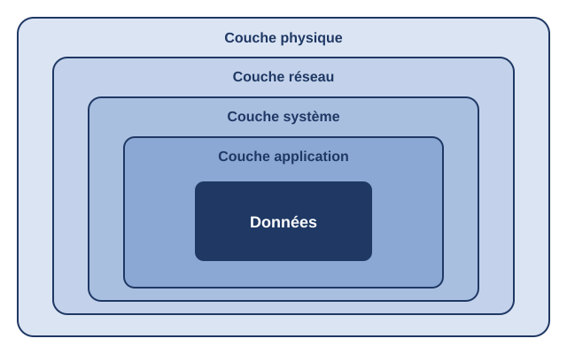

# Multilayer security applied to a logistics and transport company

[Version française](README.md)

**Bachelor's thesis (IPTMA, Networks and Telecommunications) · 2025 – 2026 · Graded 16.5/20**
**Team project** carried out with three other students, under the supervision of an IPTMA advisor.

## Summary

Security audit of a Malian SME in the logistics and transport sector, followed by the design of a security architecture based on **defense in depth**: four complementary layers (physical, network, system, application), so that an attacker has to get past several successive barriers.

The goal was a realistic, scalable and affordable architecture suited to the means of an SME.

> **Project status:** the audit was carried out on site. The solutions were designed and validated in a lab (network simulation, virtual machines). Their deployment at the company is described as a project plan. The company's name and internal data are not published.

## Approach

1. **Audit:** interviews with managers, inspection of the premises, infrastructure survey, technical tests (including badge reading with a Flipper Zero) and a review of the business application.
2. **Diagnosis** per layer, assessed against ISO/IEC 27001, the NIST Cybersecurity Framework, OWASP and ANSSI recommendations.
3. **Design** of the target architecture and **simulation** in a lab.
4. **Planning** (adapted agile methodology, about ten weeks) and **cost estimate**.

## Diagnosis summary

| Layer | Main findings | Risk level |
|-------|---------------|------------|
| **Physical** | Access control with easily cloned badges, server room without UPS or air conditioning | Critical |
| **Network** | Flat network with no segmentation or firewall, single point of failure | Critical |
| **System** | No centralized directory, antivirus or update management, obsolete telephony | High |
| **Application** | No multi-factor authentication, traceability or account lockout | High |

## Proposed solutions

**Physical layer.** UPS and air conditioning for the server room, cabling reorganization, access control with a connected smart lock, video surveillance isolated on a dedicated VLAN.

**Network layer** (simulated in EVE-NG with Cisco IOL equipment and pfSense).
- 802.1Q VLAN segmentation, one VLAN per department, plus server, voice and management VLANs
- Inter-VLAN routing on a Layer 3 switch
- pfSense firewall: stateful filtering, NAT, default rule denying all unauthorized traffic
- Redundancy: HSRP/VRRP, EtherChannel, Spanning Tree
- Hardening: SSH version 2 only, Port Security, DHCP Snooping, Dynamic ARP Inspection, logging to a Syslog server

**System layer.**
- Centralized **OpenLDAP** directory, with account security policies enforced through **PAM** (password complexity, lockout after failures, session lock after inactivity)
- **ClamAV** antivirus, tested with the EICAR test file
- **Asterisk** IP telephony isolated in a dedicated VLAN
- Update management policy

**Application layer: the LogiTrans web application** (management of drivers, vehicles, parcels and deliveries).
- MERN stack: React, Express, Node.js, MongoDB
- JWT authentication, passwords hashed with bcrypt, TLS-encrypted communications
- Role-based access control (administrator, manager, driver)
- Multi-factor authentication, logging of sensitive actions, automatic logout after 15 minutes of inactivity, account lockout after 5 failed logins
- UML modeling: use case, class, sequence, activity and deployment diagrams

## Project management and budget

About ten weeks in five phases, shown in a Gantt chart. The cost estimate is about **10.5 million FCFA**, with a majority of open-source solutions to limit licensing costs.

## Key takeaways

- Security never rests on a single measure: the combination of layers is what reduces the attack surface.
- A security architecture must account for an SME's budget constraints, hence the choice of open-source tools.
- Frameworks (ISO/IEC 27001, NIST CSF, OWASP) provide a method to assess risks and justify measures.

## Perspectives

Automated deployment with Infrastructure as Code, a security operations center backed by a SIEM, gradual adoption of a Zero Trust model, security of connected devices embedded in vehicles, and an ISO/IEC 27001 certification process.
