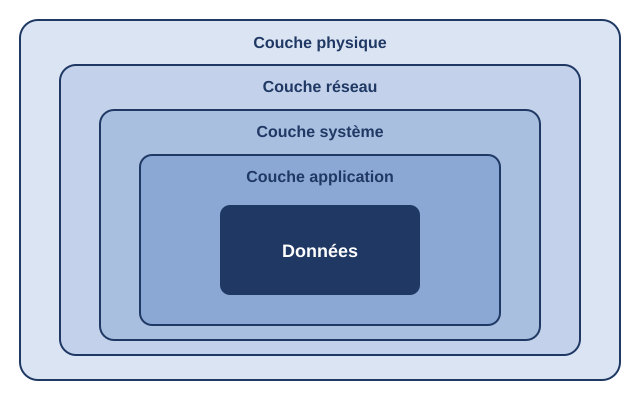

# Sécurité multicouche appliquée à une entreprise de logistique et de transport

**Mémoire de licence (IPTMA, option Réseaux et Télécommunications) · 2025 – 2026 · Soutenu avec la note de 16,5/20**
**Travail d'équipe** réalisé avec trois autres étudiantes, sous la direction d'un encadrant de l'IPTMA.

## Résumé

Audit de sécurité d'une PME malienne du secteur de la logistique et du transport, puis conception d'une architecture de sécurité fondée sur la **défense en profondeur** : quatre couches complémentaires (physique, réseau, système, applicative), pour qu'un attaquant doive franchir plusieurs barrières successives.

L'objectif : proposer une architecture réaliste, évolutive et économique, adaptée aux moyens d'une PME.

> **Statut du projet :** l'audit a été mené sur site. Les solutions ont été conçues et validées en laboratoire (simulation réseau, machines virtuelles). Leur déploiement chez l'entreprise est décrit sous forme de plan de projet. Le nom de l'entreprise et ses données internes ne sont pas publiés.

## Démarche

1. **Audit** : entretiens avec les responsables, inspection des locaux, relevé de l'infrastructure, tests techniques (dont la lecture de badges avec un Flipper Zero) et revue de l'application métier.
2. **Diagnostic** par couche, qualifié au regard d'ISO/IEC 27001, du NIST Cybersecurity Framework, de l'OWASP et des recommandations de l'ANSSI.
3. **Conception** de l'architecture cible et **simulation** en laboratoire.
4. **Planification** (méthodologie agile adaptée, environ dix semaines) et **chiffrage** du projet.

## Synthèse du diagnostic

| Couche | Constats principaux | Niveau de risque |
|--------|---------------------|------------------|
| **Physique** | Contrôle d'accès par badges facilement clonables, salle serveur sans onduleur ni climatisation | Critique |
| **Réseau** | Réseau plat sans segmentation ni pare-feu, point unique de défaillance | Critique |
| **Système** | Pas d'annuaire centralisé, d'antivirus ni de gestion des mises à jour, téléphonie obsolète | Élevé |
| **Applicative** | Pas d'authentification multifacteur, de traçabilité ni de verrouillage de compte | Élevé |

## Solutions proposées

**Couche physique.** Onduleur et climatisation pour la salle serveur, réorganisation du câblage, contrôle d'accès par serrure connectée, vidéosurveillance isolée sur un VLAN dédié.

**Couche réseau** (simulée sous EVE-NG avec des équipements Cisco IOL et pfSense).
- Segmentation par VLAN 802.1Q, un VLAN par département, plus des VLAN serveurs, voix et gestion
- Routage inter-VLAN sur switch de niveau 3
- Pare-feu pfSense : filtrage stateful, NAT, règle par défaut qui refuse tout flux non autorisé
- Redondance : HSRP/VRRP, EtherChannel, Spanning Tree
- Durcissement : SSH version 2 uniquement, Port Security, DHCP Snooping, Dynamic ARP Inspection, journalisation vers un serveur Syslog

**Couche système.**
- Annuaire centralisé **OpenLDAP**, avec politiques de sécurité des comptes appliquées par **PAM** (complexité des mots de passe, verrouillage après échecs, verrouillage de session après inactivité)
- Antivirus **ClamAV**, testé avec le fichier de test EICAR
- Téléphonie IP **Asterisk** isolée dans un VLAN dédié
- Politique de gestion des mises à jour

**Couche applicative : application web LogiTrans** (gestion des chauffeurs, véhicules, colis et livraisons).
- Pile MERN : React, Express, Node.js, MongoDB
- Authentification par jeton JWT, mots de passe hachés avec bcrypt, communications chiffrées en TLS
- Contrôle d'accès par rôles (administrateur, gestionnaire, chauffeur)
- Authentification multifacteur, journalisation des actions sensibles, déconnexion automatique après 15 minutes d'inactivité, verrouillage du compte après 5 échecs de connexion
- Modélisation UML : cas d'utilisation, classes, séquence, activités, déploiement

## Gestion de projet et budget

Planning sur environ dix semaines en cinq phases, présenté sous forme de diagramme de Gantt. Le chiffrage estimatif s'établit à environ **10,5 millions de FCFA**, avec une majorité de solutions open source pour limiter les coûts de licence.

## Ce que j'en retiens

- La sécurité ne repose jamais sur une seule mesure : c'est la combinaison des couches qui réduit la surface d'attaque.
- Une architecture de sécurité doit tenir compte des contraintes financières d'une PME, d'où le choix d'outils open source.
- Les référentiels (ISO/IEC 27001, NIST CSF, OWASP) donnent une méthode pour qualifier les risques et justifier les mesures.

## Perspectives

Déploiement automatisé par Infrastructure as Code, centre opérationnel de sécurité appuyé sur un SIEM, adoption progressive du modèle Zero Trust, sécurité des objets connectés embarqués dans les véhicules, démarche de certification ISO/IEC 27001.
